# Tetherbore

A one-thumb mining game for the phone browser. A core sits fixed at the centre of a vast world and your drill flies from it on a tether. Cut round a piece of ground, wind the tether about it, and the core reels the whole piece in.

**[Play it in the browser](https://skulitom.github.io/Tetherbore/)**, also on [itch.io](https://skulitom.itch.io/tetherbore). English, Russian (`?lang=ru`) and Mandarin (`?lang=zh`).

<p align="center">
  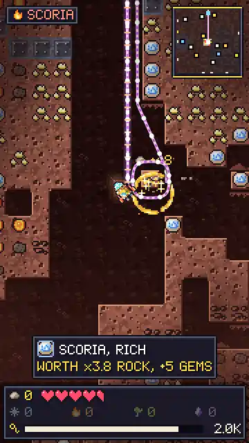
  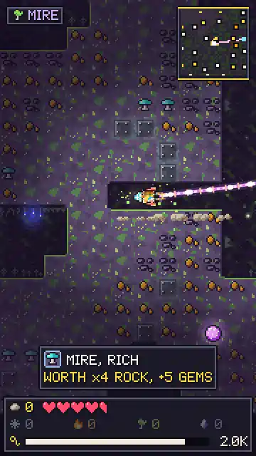
  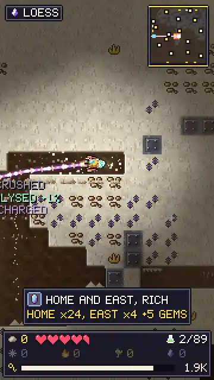
</p>
<p align="center">
  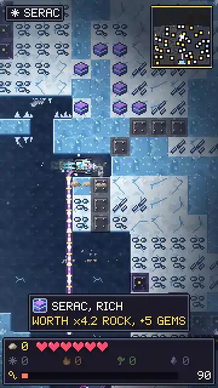
  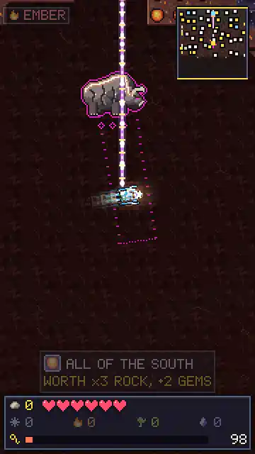
</p>

## How it plays

- **Press anywhere and drag** to fly; pushed into ground, the drill cuts. Arrow keys or WASD on a desktop.
- **With a controller:** stick or d-pad to fly and to move through a panel, A to press (at the core, the shop), B back, X the lab, Y the map, LB and RB the tabs, LT and RT page the lab and zoom the map, Start the menu, View the panel.
- **The tether is a lasso.** Cut a piece of ground free, take the tether round it, and it is reeled home and paid out at the core.
- **Only hauls pay.** Drilling through ore crushes it. The bigger the piece and the further out, the more it is worth.
- **Four directions, each with rules of its own:** ice in the north, lava in the south, spore-pod caves in the west, slate and charged crystals in the east, and seams, strains and crossed grounds between them.
- **Four lords at the ends**, 2,210 cells out on each axis, and something sealed in ancient stone at 2,000.

<p align="center">
  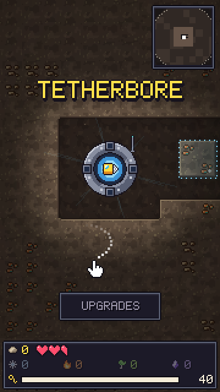
  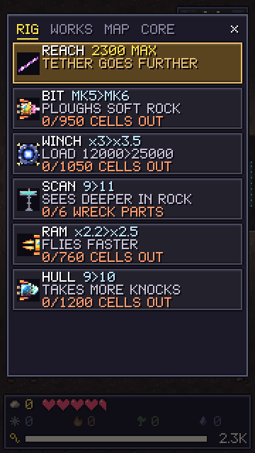
  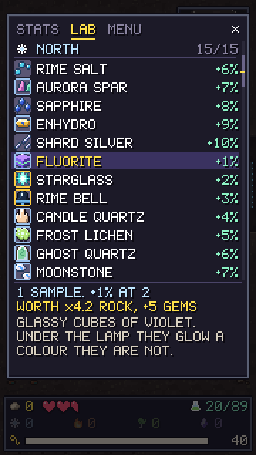
  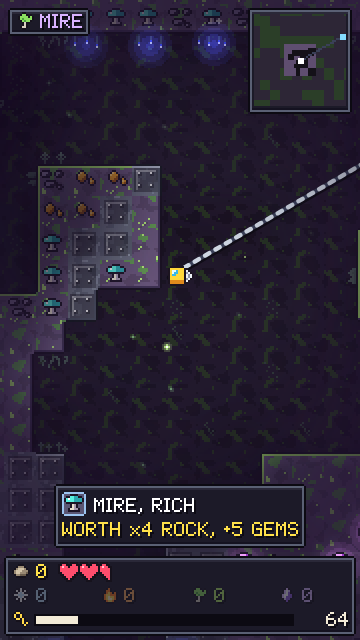
  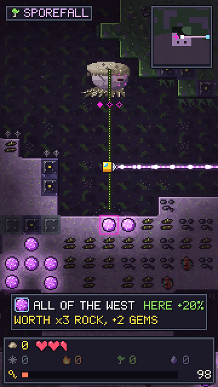
  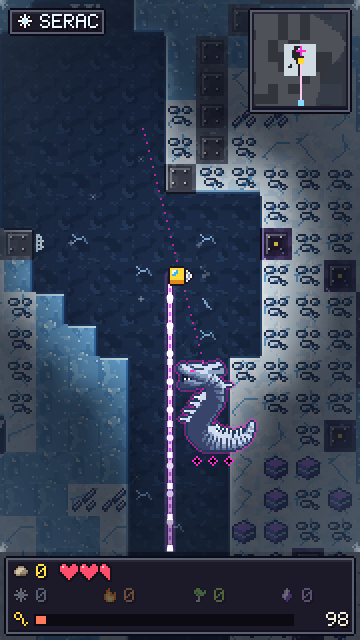
</p>

## Running it

A static site with no build step: serve the folder and open `index.html`.

```bash
python -m http.server 4791
node test/all.mjs
```

Progress is saved on the device; there is no server and no account. Every sprite and tile is made with [Pixelbolt](https://github.com/skulitom/Pixelbolt), and every sound and the music is made in code.

The clips above are made by `node tools/clip.mjs docs/media/<name>.webp` (a small pilot plays the game headless and ffmpeg encodes it), the stills by `node tools/shot.mjs`.

**[docs/REFERENCE.md](docs/REFERENCE.md)** has everything else: the full rules, how it is built, tested and measured, the tools, and the art. [DESIGN.md](DESIGN.md) has the original goal and pillars.
